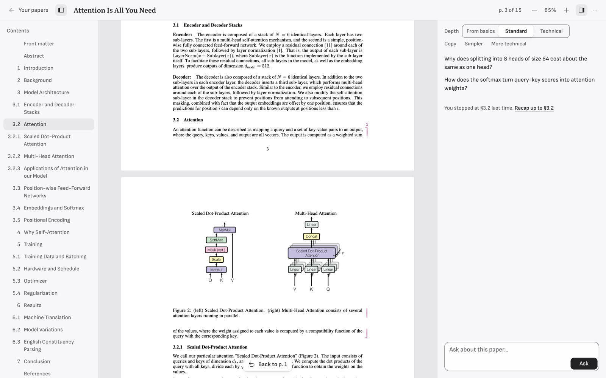
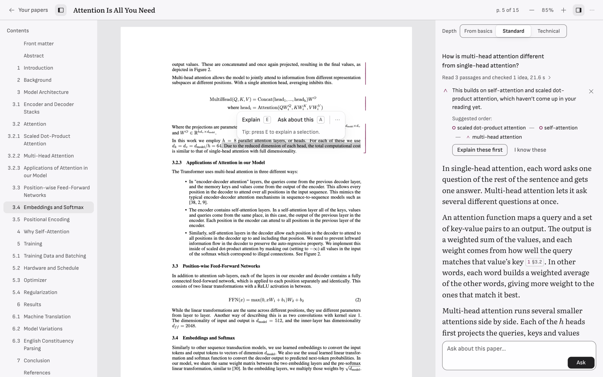
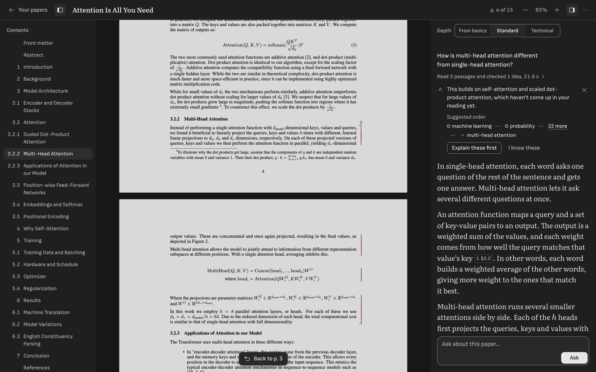

# PaperMind

A research-paper reading agent that explains at your level. Open a paper (an
arXiv link or your own PDF), read it, and ask questions in the margin. Answers
are built on the passages of the paper that actually answer the question, cite
them with numbered pencil brackets drawn beside the exact lines, and are pitched
for the reader: a beginner and a researcher get different explanations, and the
prerequisites this particular reader hasn't met yet are named and offered first.



| | |
|---|---|
|  |  |

## How a question flows

```
Browser · React (via Caddy)              reads the PDF, asks in the margin
   │  POST /api/chat (question + session id)   ← SSE: typed events
   ▼
FastAPI (stateless workers) ───────────── Redis: session, scroll position, transcript (24 h TTL)
   │
   ▼
Agent loop · Claude (hand-written ReAct, papermind/agent/loop.py)
   │  Pydantic-validated tool I/O; a malformed call goes back to the model as an error to fix
   │  independent tool calls in one step run together (asyncio.gather)
   ├── MCP retriever         BM25 + dense (bge-base, FAISS) → Reciprocal Rank Fusion → top 5 passages
   ├── MCP prereq_graph      Neo4j, 359 ML concepts, BFS over REQUIRES minus what you KNOW
   └── MCP semantic_scholar  look up cited papers, references, citations (cached, rate-limited)
   │  compose_answer(plan, sources, concepts to scaffold)   ← the hand-off
   ▼
Writer · Claude with a level rubric       cites [S1] passages and [P1] papers
   ▼
Mastery pass                              what your question revealed → KNOWS edges (with Undo)
```

The agent model decides *what context is needed*; the writer decides *how to say
it*. The writer sits behind a small `Writer` protocol: Claude today, or the
fine-tuned Mistral 7B adapter from `training/` (`WRITER_BACKEND=mistral`),
with no change to the loop.

Concept mastery is the one piece of state that must outlive a session, so it
lives in Neo4j as `(:User)-[:KNOWS {confidence, source, evidence}]->(:Concept)`
edges next to the `REQUIRES` graph; everything that can be lost after a day
(transcript, scroll position) lives in Redis.

Full contract: [`docs/architecture/ARCHITECTURE.md`](docs/architecture/ARCHITECTURE.md).
Design system and UI spec: [`docs/design/DESIGN.md`](docs/design/DESIGN.md).

## Quick start (macOS)

```bash
brew install redis neo4j uv node        # once
neo4j-admin dbms set-initial-password papermind-dev   # once, before Neo4j's first start

make install                            # Python 3.11 venv + deps, frontend deps
cp .env.example .env                    # then set ANTHROPIC_API_KEY
make services                           # start Redis + Neo4j
make seed                               # load the 359-concept prerequisite graph
make ingest-benchmark                   # the 8 benchmark papers (or: make ingest ARXIV=1706.03762)

make dev                                # API on :8000 (spawns the three MCP servers)
make frontend                           # http://localhost:5173
```

From the terminal, without the UI:

```bash
make ask PAPER=1706.03762 LEVEL=beginner Q="Why divide by the square root of d_k?"
```

`make help` lists everything.

## Evaluation

Benchmark: `evals/benchmark/questions.jsonl`, 174 questions over 8 papers
(Transformer, BERT, ResNet, Adam, LoRA, DPO, ViT, BatchNorm): 150 generated
backwards from a gold passage, plus 24 written in natural phrasing that avoids
the passage's vocabulary. Each row has a gold chunk id, target level and
reference answer, and every label was checked by an independent pass.

**Retrieval ablation** (`make eval-retrieval`, no API key needed, ~10 s):

| | recall@5 | recall@10 | MRR@10 |
|---|---|---|---|
| BM25 alone | 85.6% | 90.2% | 0.733 |
| Dense alone | 89.7% | 92.5% | 0.706 |
| **Hybrid (RRF, k = 60)** | **89.7%** | **94.8%** | **0.798** |

On generated questions the three tie at recall@5 (≈ 92.7%) and hybrid wins on
recall@10 and MRR. On natural phrasing BM25 collapses to 37.5% while dense holds
75%; the arms fail on different questions, which is the case for fusing them.
Details and per-paper / per-query-type tables are in the run files under
`evals/results/`.

**Agent suites** (spend API money; W&B offline by default):

```bash
make eval                 # faithfulness, token F1, calibration (blind judge), citation precision,
                          # uncited paper-derived paragraphs, latency p50/p95, cost per question
make eval-latency LIMIT=24   # A/B: sequential tools + no prompt caching vs asyncio.gather + caching
make eval-label-sheet     # 30 answers to hand-label, then `make eval-agreement` for judge agreement
```

Measured on one question (Transformer paper, Standard depth): 4 model calls,
the agent's second step reading ~7 K tokens from the prompt cache, first answer
word after ~8.7 s, about $0.07 per question.

## Tests

```bash
make test        # 1,163 Python unit tests: no Redis, Neo4j, network or API key
make test-int    # integration: real Redis, Neo4j, arXiv, Semantic Scholar, MCP over stdio
cd frontend && npm test && npm run build
```

## Deploy

One server runs everything: `infra/docker-compose.yml` starts Caddy (the
built frontend plus automatic HTTPS), the API with 4 workers, the three MCP
servers as separate HTTP services, Redis and Neo4j. On a fresh Ubuntu server,
`bash infra/setup-server.sh` does the whole install. Because every question
runs on your Anthropic key, a public server turns on the guards in
`papermind/api/guards.py`: an access code, per-visitor rate limits, and a daily
spend ceiling fed by the cost of every model call. Step by step, with costs:
[`DEPLOY.md`](DEPLOY.md).

## Layout

```
papermind/        config, schemas, ingest, retrieval, graph, scholar, memory, llm, mcp_client, agent, api
mcp_servers/      retriever, prereq_graph, semantic_scholar
data/concepts/    the prerequisite graph seed (tracked)
data/papers/      ingested papers: paper.json tracked for the benchmark, PDFs ignored
evals/            harness, benchmark, pytest suites
frontend/         React + Vite + TypeScript
infra/            Dockerfiles, compose, Caddyfile, server setup script + systemd unit
docs/             architecture, design spec, screenshots
```

## Fine-tuning the writer

`training/` distils Claude's level-calibrated answers into Mistral 7B with
QLoRA SFT, then DPO. The fine-tuned model serves through vLLM behind
`WRITER_BACKEND=mistral`, and `make eval-writer` measures calibration for the
base vs tuned model with retrieval held fixed. The data steps run on your
laptop; training needs a rented NVIDIA GPU (about 2 hours on an A100). Steps,
costs and settings: [`training/README.md`](training/README.md).

## Not built yet

- From the design spec: find-in-paper, your own highlights and "Your marks",
  pinning answers to the page, the phone bottom-sheet detents, and the
  Appearance popover (theme and page mode are in Settings). "Background" labels
  on uncited paragraphs stay off until the uncited-paragraph eval gate passes.
